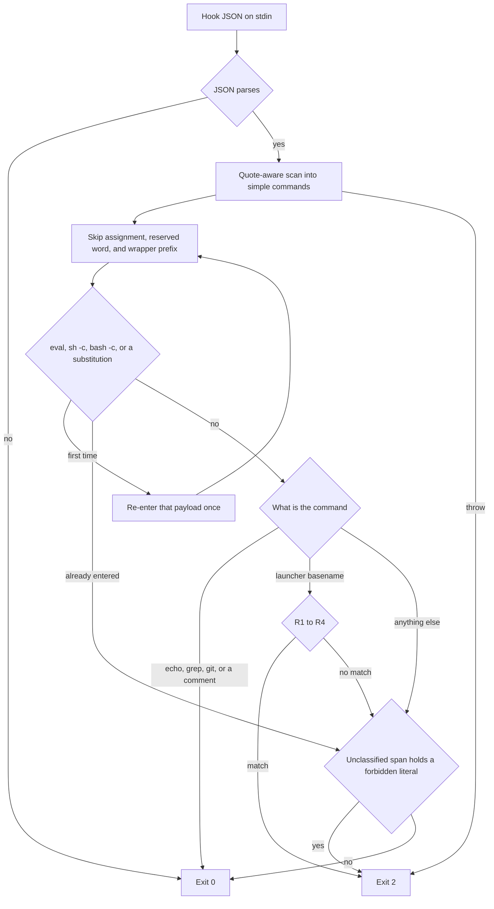

# Live Executor Guard Scan - Plan

## Goal Capsule

- **Objective:** An autonomous session can run the repo's zero-spend scripts and the stub executor, and it still cannot start a real-spend run through the four accident shapes, including when those shapes are chained, wrapped, or glued to a redirect.
- **Means:** One quote-aware scan, then the four predicates (KTD1).
- **Authority:** Product Contract requirements win on behavior. Planning Contract decisions win on mechanism. Assumptions fill edges the request left unnamed and do not override a requirement.
- **Execution:** Code change in the existing hook and its vitest table.
- **Stop:** Do not run a live executor, `npm run runner`, or `run approve`. Do not edit the settings deny and allow lists, the session-start script, or the short ban lists. Do not add deliberate-bypass coverage.
- **Finishes:** The implementing agent lands U1 and U2. A human reviews and merges.

---

## Product Contract

### Summary

The live-executor hook becomes the four-predicate accident check its header already describes. Ordinary repo scripts and the stub executor stay usable. Chained, wrapped, and redirect-glued forms of the four real-spend shapes stay blocked.

### Problem Frame

The hook's header, and issue #100, define an accident-level guardrail. Settings deny rules and the short ban lists are the primary control, and deliberate bypasses are frozen. The body is a partial shell-and-interpreter simulator. That simulator misses `npm run runner>run.log`, which issue #100 names as the accident to fix first, and it blocks the documented zero-spend scripts because it opens them. The test table now specifies the simulator's dialect, which is why the parser cannot shrink.

### Key Decisions

- **Accident check, not a shell simulator.** (session-settled: user-directed — chosen over another parser branch and over splitting the file: either one keeps the dialect the hook was not supposed to grow.) Governs R1, R2, R3, R4, R5, R7, R9.
- **Settings and the ban lists stay the primary control.** (session-settled: user-directed — chosen over widening deny rules, hook wiring, session start, or the ban lists: the hook covers chained and wrapped forms those prefix rules miss.) Governs R12.
- **Closed files, no interpreter classification.** (session-settled: user-directed — chosen over opening scripts, expanding braces, decoding ANSI-C quotes, and classifying interpreters: those reads are what block the ordinary repo scripts.) Governs R8, R9.
- **No second shell language.** (session-settled: user-directed — chosen over calling the product tokenizer and over a second shell dialect: the tokenizer returns no argv on the metacharacters this hook has to split.) Governs R13.

### Requirements

**Accident shapes**

- R1. Block a package-manager `run` or `run-script`, and the pnpm or yarn implicit form, whose script is `runner`.
- R2. Block a positional `run` followed later by `approve`.
- R3. Block `--executor` or `--executor=` equal to `claude-code` or `agx-claude-code`.
- R4. Block an argument ending in `backend/src/runner.ts`.
- R5. R1–R4 hold with `--prefix`, `-w`, `--filter`, or `--cwd`, after `&&`, `;`, `|`, `&`, or parentheses, after a leading assignment or the wrapper prefix `env`, `sudo`, `timeout`, `nohup`, or `command`, and inside one level of `sh -c`, `bash -c`, `eval`, `$(...)`, or backticks.

**Allows**

- R6. A command the scan can classify is allowed when it matches none of R1–R4, including `npm test`, `npm run typecheck`, `npm run eval`, `npm run cli` with `--executor stub`, an `echo`, `grep`, or `git` argument, a `#` comment, and a name such as `runner.json`.
- R7. An unquoted `<` or `>` separates words, so `npm run runner>run.log` is the script `runner`.
- R8. `node scripts/installed-protocol-smoke.mjs`, `bash scripts/install-smoke.sh`, `bash scripts/operator-real-run-recipe.sh`, and `bash scripts/operator-committed-source-paths.sh` are allowed, and the hook does not read those files.
- R9. A forbidden literal in a span the scan cannot classify is blocked.

**Process and boundaries**

- R10. Malformed hook JSON exits 0.
- R11. Every exit 2 writes `Blocked: ${reason}. Real-spend commands are human-only (goal-gen/CLAUDE.md). Use --executor stub for tests.` An internal failure is one of those exits.
- R12. The deny and allow lists in `.claude/settings.json`, the PreToolUse and SessionStart wiring, `.claude/hooks/session-start.sh`, and the short ban lists in `CLAUDE.md`, `AGENTS.md`, and `goal-gen/CLAUDE.md` stay as they are.
- R13. The hook leaves `tokenizeSimpleCommand` unused and does not implement a second shell language.

### Actors

- A1. Autonomous Claude Code session. Its Bash tool is the caller this hook gates.
- A2. Human operator. Real-spend entry points stay reserved for A2.

### Acceptance Examples

- AE1. `npm run --prefix goal-gen runner` exits 2. Covers R1, R5.
- AE2. `npm run test -- runner` exits 0. Covers R6.
- AE3. `echo "npm run runner"` exits 0, and `echo "$(npm run runner)"` exits 2. Covers R5, R6.
- AE4. With cwd `goal-gen/`, `node scripts/installed-protocol-smoke.mjs` exits 0. Covers R8.
- AE5. Stdin `{` exits 0 and writes no stderr. Covers R10.

### Success Criteria

- With the hook's cwd set to `goal-gen/`, the four commands in R8 exit 0, and `npm run runner` still exits 2.

### Scope Boundaries

- The hook covers the chained and wrapped forms the settings prefix rules miss: `cd … &&`, pnpm and yarn, `--prefix` and the other package-manager flags, `--executor`, and `backend/src/runner.ts`.
- Settings deny today is three prefixes: `npm run runner`, `npm run cli -- run approve`, and `goal-gen run approve`. Those lines stay.
- Out of scope: coproc, bare `npm run-`, string-form `execSync`, ANSI-C quotes, brace expansion, heredocs used as programs, script-body greps, glob fail-close, and the rest of issue #100's parked bypass list.
- Out of scope: editing `goal-gen/AGENTS.md`, which repeats the same ban sentence and was not one of the three named lists.
- Out of scope: a new agent path for live spend or `run approve`.

### Sources

- `.claude/hooks/guard-live-executor.mjs` — process contract, the four predicates, and the file-open path that blocks R8.
- `goal-gen/tests/claude-hooks/guard-live-executor.test.ts` — current block and allow tables. The temp cwd in the helper does not exercise R8.
- `goal-gen/backend/src/inspection/detectors/commands.ts` — `tokenizeSimpleCommand` returns no argv when the line contains shell metacharacters. R13.
- `.claude/settings.json` — deny and allow prefixes and the PreToolUse / SessionStart wiring. R12.
- Issue #100, "Live-run guard: bypass findings parked after the scope freeze" — the freeze, and the unfrozen accident `npm run runner>run.log` with fd redirects such as `2>&1` kept together.

---

## Planning Contract

### Key Technical Decisions

- KTD1. **Quote-aware words, then the launcher predicates.** (session-settled: user-directed — chosen over another parser branch and over splitting the file: the four predicates are the policy, and the simulator is what the test table is specifying.) Governs R1, R2, R3, R4, R5, R6. The scan splits unquoted input on whitespace, quotes, comments, and `;|&()`. Command identity is the last path segment. The predicates run when that segment is `npm`, `pnpm`, `yarn`, `npx`, `tsx`, `node`, `goal-gen`, or `goal-gen.mjs`. A leading `--` is skipped until the subcommand, so `npm -- run runner` and `npx -- npm run runner` are still R1. After that subcommand, `runner` matches anywhere before the next `--`, so a flag value is not the script. When `run` is the last word before that `--`, the next word counts, so `npm run -- runner` is R1. `npm run test -- runner` is R6. A positional `run` followed later by `approve` is R2, including `npm run test -- approve`. `--executor` is read on every argument, including after `--`. The `runner.ts` suffix is read on every argument. `echo`, `grep`, and `git` do not run these checks on their own arguments. Conflict: a narrower R2 that only blocked the approval subcommand would allow `npm run test -- approve`. This plan keeps the current match because the request pointed at that predicate.
- KTD2. **A redirect stays inside the same simple command.** (session-settled: user-directed — chosen over another redirect branch in the old parser: `<` and `>` are separators, so `runner>run.log` is the word `runner`.) Governs R7. The target is not a later command word. A redirect written before the command does not end the command.
- KTD3. **One re-entry, then R9.** (session-settled: user-directed — chosen over a second shell dialect: `eval`, `sh -c` / `bash -c`, and one `$(...)` or backtick body are re-entered by the same scan.) Governs R5, R9, R13. A second depth is not entered. Text that still holds a forbidden literal and was not entered is R9. Carriers outside that list, including file reads, `find -exec`, `npm exec -c`, and `env -S`, are not added.

### High-Level Technical Design

Stdin is hook JSON. A string `cwd` overrides the process cwd. The scan below is the whole classifier. Exit 0 allows. Exit 2 blocks.

### Assumptions

These are working defaults for edges the request did not name. They do not add product scope.

- Asm1. A newline ends a simple command the way `;` does, and a `#` comment ends at that newline. Pin: `cd goal-gen` plus a newline plus `npm run runner` exits 2. Pin: `npm run cli -- run r.json --executor stub` plus a newline plus `echo approve` exits 0.
- Asm2. A glued redirect does not eat a trailing digit. `runner>run.log` and `runner>&1` are the word `runner` (exit 2). `runner2>&1` and `runner2>file` are the word `runner2` (exit 0), which is what bash executes. A standalone redirect token (`2>&1`, `>&1`, `&>file`, `>>file`) is dropped whole, so its `&` is not a command separator. `>/dev/null npm run runner` exits 2. `npm run runner 2>&1` exits 2.
- Asm3. Leading reserved words are `if`, `then`, `elif`, `else`, `do`, `while`, `until`, `{`, `}`, `!`, `time`, and `function`. `time` may take a leading `-p`. Every leading `NAME=value` is skipped. Pin: `if true; then npm run runner; fi` exits 2. Pin: `time -p npm run runner` exits 2. Pin: `A=1 B=2 npm run runner` exits 2.
- Asm4. Wrapper options are consumed until the payload. `timeout` skips its flags, the argument of `-s`, `--signal`, `-k`, or `--kill-after`, and one duration word. `sudo` skips flags, and `-u` or `--user` takes the next word. `env` skips flags, the argument of `-u` or `--unset`, and `NAME=value`. `nohup` and `command` skip flags only. `command -v` and `command -V` allow. The five names may chain. `env -S` is not a new carrier. `setsid`, `nice`, `xargs`, `watch`, and the rest of the old wrapper table are not unwrapped, so `setsid npm run runner` exits 0. Pin: `timeout -s TERM 30 npm run runner` exits 2. Pin: `env -u FOO npm run runner` exits 2.
- Asm5. An option cluster on `sh` or `bash` that contains `c` counts as `-c`, and one `--` immediately after that cluster is skipped. `eval` joins its words with a space. Every `$(...)` and backtick at that one extra depth is entered, including inside double quotes, and not inside single quotes. Pin: `sh -lc 'npm run cli -- run approve'` exits 2. Pin: `bash -c -- 'npm run runner'` exits 2. Pin: `eval npm run runner` exits 2.
- Asm6. The script words are `run`, `run-script`, and the spellings npm already accepts for that same subcommand: `rum`, `urn`, and `run-s` through `run-scrip`. Bare `run-` does not match. A glob in the subcommand is not fail-closed. Pin: `npm rum runner` exits 2. Pin: `npm run- runner` exits 0.
- Asm7. `<<` introduces a data body. The body is not a command list, so a `cat` heredoc that only mentions `npm run runner` exits 0. A `$(...)` or backtick in an unquoted heredoc body is the one re-entry from KTD3, so that form exits 2. A quoted delimiter is not expanded. A heredoc used as a program may exit 0. That is the dropped heredoc-as-program behavior.
- Asm8. A backslash-newline joins the words on either side. A forbidden literal is a predicate word, not a substring. Pin: `npm run` plus a backslash-newline plus `runner` exits 2.
- Asm9. R8 is about the typed command line. The test passes cwd `goal-gen/`, or a fixture that contains those four scripts. A missing file is not the behavior under test.

### Sequencing

U1 writes the reduced table first. The current hook fails the new allows and `npm run runner>run.log`. U2 replaces the scanner until that table passes.

---

## Implementation Units

### U1. Cut the hook test table to the accident contract

- **Goal:** The vitest table states R1–R11 and the Assumption pins, and it no longer specifies the simulator dialect.
- **Requirements:** R1–R11. Assumption pins Asm1–Asm9.
- **Dependencies:** none.
- **Files:** `goal-gen/tests/claude-hooks/guard-live-executor.test.ts`
- **Approach:** Keep the subprocess spawn of `.claude/hooks/guard-live-executor.mjs` and the JSON stdin shape. Delete the planted interpreter fixtures and every row that exists to feed file reads, ANSI-C, braces, heredocs-as-programs, or script-body greps. R8 rows pass cwd `goal-gen/` per Asm9.
- **Execution note:** Write this table first. The current hook should fail R8 and `npm run runner>run.log` before U2.
- **Patterns to follow:** The existing `spawnSync` helper and the status-only assertion in this file.
- **Test scenarios:**
  - `npm run runner`, `npm run-script runner`, `pnpm runner`, `yarn runner`, `npm -- run runner`, and `npx -- npm run runner` each exit 2.
  - `npm run --prefix goal-gen runner`, `npm run -w goal-gen runner`, `pnpm --filter goal-gen runner`, and `yarn --cwd goal-gen runner` each exit 2.
  - `npm run cli -- run --id 3 approve` exits 2.
  - `npm run cli -- run r.json --executor claude-code` and the same line with `--executor=agx-claude-code` each exit 2.
  - `npx tsx backend/src/runner.ts` exits 2.
  - `npm run runner>run.log` exits 2.
  - `true && npm run runner`, `true; npm run runner`, `true | npm run runner`, `sleep 1 & npm run runner`, and `(npm run runner)` each exit 2.
  - `FOO=1 npm run runner`, `env FOO=1 npm run runner`, `timeout 600 npm run runner`, `sudo -u me npm run runner`, and `nohup npm run runner &` each exit 2.
  - `bash -c "npm run runner"`, `eval "npm run runner"`, `echo "$(npm run runner)"`, and `` echo `npm run runner` `` each exit 2.
  - `npm test`, `npm run typecheck`, `npm run eval`, and `npm run cli -- run r.json --executor stub` each exit 0.
  - `echo "npm run runner"`, `grep "npm run runner" CLAUDE.md`, `git commit -m "block npm run runner in the guard"`, `# npm run runner`, and `npm run cli -- run runner.json --executor stub` each exit 0.
  - `npm run test -- runner` exits 0.
  - With cwd `goal-gen/`, the four R8 commands each exit 0.
  - Each Assumption that names an exit code has one row with that command and that exit code.
  - Stdin `{` exits 0 and writes no stderr.
  - A blocked command exits 2 and its stderr is the R11 sentence.
- **Verification:** The file's rows are the list above plus the Assumption pins. It does not plant scripts for the hook to read.

### U2. Replace the simulator with the scan

- **Goal:** The hook implements KTD1–KTD3 and the Assumptions, and the U1 table passes.
- **Requirements:** R1–R13. Key Decisions govern those Rs. KTD1, KTD2, KTD3.
- **Dependencies:** U1
- **Files:** `.claude/hooks/guard-live-executor.mjs`
- **Approach:**
  - Keep JSON stdin, the optional string `cwd`, exit 0, exit 2, and the R11 stderr sentence.
  - Delete the simulator: ANSI-C decoding, command-substitution placeholders, heredoc bodies attached to commands, brace expansion, the wrapper and interpreter tables, file reads, and regex scans of Node, Python, Perl, and Ruby source.
  - Classify with one quote-aware scan as KTD1–KTD3, using Assumptions for the unnamed edges.
  - Replace the header sentences that describe a shell tokenizer. Keep the paragraph that says this is an accident guardrail and that settings plus the ban list stay the primary control.
- **Patterns to follow:** The current stdin and exit handling at the bottom of the hook. Do not import `goal-gen` source.
- **Test scenarios:** U1 is the behavioral proof. This unit adds no second suite.
- **Verification:** U1 passes. The hook source no longer reads files, decodes ANSI-C, expands braces, or classifies interpreters. `.claude/settings.json`, `.claude/hooks/session-start.sh`, `CLAUDE.md`, `AGENTS.md`, and `goal-gen/CLAUDE.md` are unchanged.

---

## Verification Contract

Run from `goal-gen/`. Leave `npm run runner`, `run approve`, and every live executor unrun.

- Hook table: `npm test -- tests/claude-hooks/guard-live-executor.test.ts` proves U1 and U2.
- Default suite: `npm test` proves the hook file stays in the default vitest project and this change does not break other tests.
- Typecheck is not a gate for this hook. The file is plain ESM outside the TypeScript include.

---

## Definition of Done

- U1 and U2 meet their verification.
- The four R8 commands exit 0 with cwd `goal-gen/`, and `npm run runner` exits 2.
- Settings, session-start, and the three ban lists have no diff from this work.
- The hook no longer contains the simulator behaviors U2 deletes.
- Abandoned experiments are not left in the diff.
- No live executor, `npm run runner`, or `run approve` was run to prove this plan.

---

## System-Wide Impact

A1 regains Bash access to the documented zero-spend scripts. A2 remains the only party who can start real spend. R3 and R4 are the only mechanical blocks for `--executor` and `backend/src/runner.ts`, because the settings prefixes do not name them. The stub path in R6 stays the agent-accessible run.

---

## Risks & Dependencies

- The cut allows forms the old table blocked: file bodies, ANSI-C, `setsid`, and string-form `execSync`. That is the issue #100 freeze, and it is the point of R8 and R9.
- R2 blocks `npm run test -- approve`. See the conflict on KTD1.
- Treating a newline as ordinary whitespace would hide `npm run runner` on the next line, or would let a later `approve` trip R2 on a stub line. Asm1 is the mitigation.
- `/usr/bin/npm run runner` is blocked only because KTD1 uses the last path segment. Dropping that step lets a path-qualified launcher through, and the settings prefix does not match it either.
